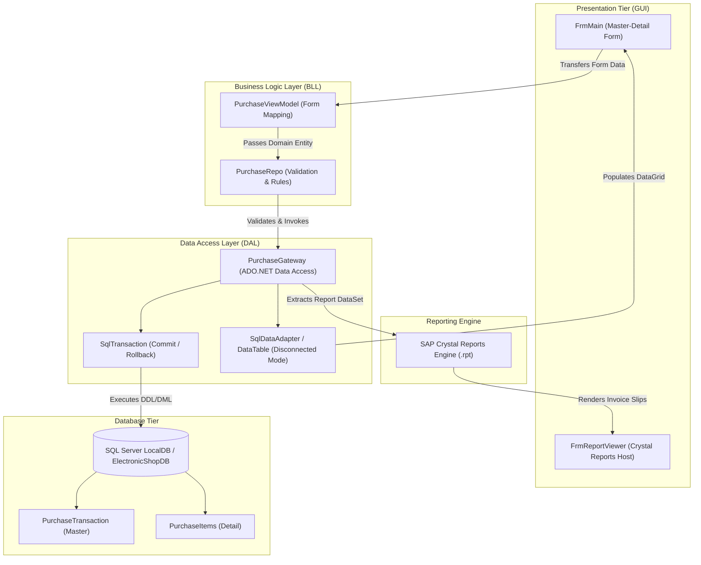
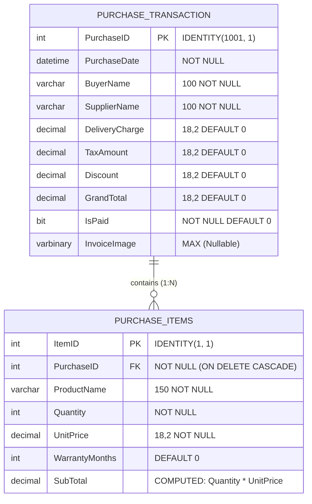

# Electronics Shop Management ERP (3-Tier WinForms & SAP Crystal Reports)

[](https://dotnet.microsoft.com/)
[](#architecture--data-flow)
[](https://learn.microsoft.com/en-us/dotnet/framework/data/adonet/)
[](https://www.sap.com/)
[](https://www.microsoft.com/sql-server)
[](LICENSE)

An enterprise 3-Tier Desktop Enterprise Resource Planning (ERP) application developed in **C# Windows Forms (.NET Framework 4.8)**. The application implements classical enterprise desktop patterns: **3-Tier Separation of Concerns** (Presentation, BLL, DAL), **ADO.NET Disconnected Mode** (`SqlDataAdapter`, `DataTable`), atomic multi-table transactions (`SqlTransaction`), binary receipt streaming (`VARBINARY(MAX)`), and grouped invoice voucher generation via **SAP Crystal Reports**.

---

## 1. Domain Problem & System Overview

Commercial electronics hardware retail and distribution businesses process high-volume, multi-item purchase orders from computer distributors and part manufacturers. Key operational requirements include:
- **Master-Detail Purchasing:** Capturing purchase order metadata (supplier, buyer, order date, delivery fees, tax, discounts, and payment status) along with dynamic line items (product name, quantity, unit price, and warranty terms).
- **Financial Integrity:** Guaranteeing that header grand totals reconcile with item sub-totals, delivery charges, VAT/tax, and discounts without arithmetic drift.
- **Physical Voucher Archiving:** Attaching scanned physical paper bills and receipts directly to transactions as binary data to support accounting audits.
- **Transactional Consistency:** Ensuring that if any single line item fails during a database insert, the entire order is rolled back cleanly.
- **Voucher Reporting:** Generating print-ready invoice slips with company headers, line-item breakdowns, and supplier groupings.

This system provides a high-efficiency Windows desktop interface engineered to streamline vendor order entry, dynamic line addition, live calculation, keyword searching, and Crystal Reports printing.

---

## 2. Architecture & Data Flow

The solution follows a strict **3-Tier Enterprise Architecture**, ensuring presentation controls never execute direct SQL statements.



### 3-Tier Layer Breakdown:
1. **Presentation Tier (`FrmMain.cs`, `FrmReportViewer.cs`):**
   - Handles Windows Forms events, user interactions, dynamic line item grid updates, invoice photo previews, and Crystal Report viewer hosting.
2. **Business Logic Layer (`Repository/PurchaseRepo.cs`, `ViewModels/`):**
   - Enforces business rules: validates buyer/supplier names, ensures order items are not empty, validates positive grand totals, and formats currency strings (`৳`).
3. **Data Access Layer (`DAL/PurchaseGateway.cs`):**
   - Encapsulates all SQL execution, connection pooling, `SqlTransaction` boundaries, and parameterized SQL queries to protect against SQL injection.

---

## 3. Relational Database Schema & T-SQL Design



### Key Database Highlights:
- **Auto-Calculated Column:** `SubTotal AS ([Quantity] * [UnitPrice])` ensures mathematical consistency at the database engine level.
- **Cascade Deletion:** `ON DELETE CASCADE` automatically purges all detail child items whenever a purchase order header is deleted.
- **Binary Image Storage:** `InvoiceImage VARBINARY(MAX)` stores receipt photos directly within SQL Server, eliminating broken local file paths during database backups.

---

## 4. Key Engineering Implementation Features

### A. Atomic Master-Detail Transaction (`SqlTransaction`)
When saving an order with multiple items:
```csharp
using (SqlConnection con = new SqlConnection(_conStr))
{
    con.Open();
    using (SqlTransaction tran = con.BeginTransaction())
    {
        try
        {
            // 1. Insert Master Header & capture SCOPE_IDENTITY()
            int newPurchaseID = Convert.ToInt32(cmd.ExecuteScalar());

            // 2. Insert each Child Item linking PurchaseID
            foreach (var item in pt.Items)
            {
                icmd.ExecuteNonQuery();
            }

            // 3. Commit only if all operations succeed
            tran.Commit();
            return newPurchaseID;
        }
        catch (Exception ex)
        {
            tran.Rollback(); // Revert everything on any failure
            throw;
        }
    }
}
```

### B. ADO.NET Disconnected Data Architecture
For searching and browsing orders in `DataGridView`, the application uses `SqlDataAdapter` and `DataTable`:
- Connection opens only during the `da.Fill(dt)` method and closes immediately.
- Minimizes database connection pool utilization and allows offline data filtering.

### C. SAP Crystal Reports Printable Vouchers
- **`Reports/PurchaseReport.rpt`:** Multi-section grouped report displaying supplier summary headers, item details, subtotal summaries, VAT, and invoice receipts.
- **`ReportViewer/FrmReportViewer.cs`:** Host form rendering printable invoice vouchers with print and export capabilities (PDF, Excel).

---

## 5. Repository Layout

```
ElectronicsShop/
|-- ElectronicsShop.sln                        # Visual Studio 2022 master solution
|-- Database/                                  # Database migration & schema scripts
|   +-- ElectronicShopDB_Schema_and_Seed.sql   # Complete T-SQL DDL & seed script
|-- ElectronicsShop/                           # Main WinForms Project (.NET 4.8)
|   |-- DAL/                                   # Data Access Layer
|   |   +-- PurchaseGateway.cs                 # ADO.NET commands, transactions, queries
|   |-- Models/                                # Domain entity models
|   |   |-- PurchaseTransaction.cs             # Master order entity
|   |   +-- PurchaseItem.cs                    # Detail line item entity (computed SubTotal)
|   |-- Repository/                            # Business Logic Repository
|   |   +-- PurchaseRepo.cs                    # Validation rules & gateway coordination
|   |-- ViewModels/                            # Form presentation view models
|   |   |-- PurchaseViewModel.cs               # Two-way form mapping
|   |   |-- PurchaseReportViewModel.cs         # Flat projection for Crystal Reports
|   |   +-- PurchasItemViewModel.cs
|   |-- Reports/                               # SAP Crystal Reports
|   |   |-- PurchaseReport.rpt                 # Master purchase voucher report template
|   |   +-- PurchaseItemsReport.rpt            # Line items report template
|   |-- ReportViewer/                          # Report viewing UI
|   |   +-- FrmReportViewer.cs                 # CrystalReportViewer host form
|   |-- FrmMain.cs                             # Primary desktop ERP workspace & controls
|   |-- App.config                             # Dynamic |DataDirectory| database connection
|   |-- Script.sql                             # Embedded SQL script
|   +-- ElectronicsShop.csproj                 # MSBuild C# project file
+-- README.md                                  # Enterprise engineering documentation
```

---

## 6. Setup & Local Execution Guide

### Prerequisites
1. **Visual Studio 2022** (Enterprise, Professional, or Community) with:
   - *.NET desktop development* workload.
   - *.NET Framework 4.8 targeting pack*.
2. **SAP Crystal Reports for Visual Studio:**
   - [SAP Crystal Reports Developer Edition for Visual Studio](https://www.sap.com/).
3. **Microsoft SQL Server LocalDB** or SQL Server Express.

---

### Step 1: Initialize Database
1. Open SQL Server Management Studio (SSMS) or Visual Studio **Server Explorer**.
2. Connect to `(LocalDB)\MSSQLLocalDB`.
3. Open and execute:
   ```sql
   Database/ElectronicShopDB_Schema_and_Seed.sql
   ```
   *This creates the `ElectronicShopDB` database, tables, foreign keys, computed columns, and seeds sample transactions.*

---

### Step 2: Build the Solution
Because SAP Crystal Reports uses 32-bit task hosts for embedded `.rpt` resource compilation, build via Visual Studio or Visual Studio MSBuild:

```powershell
# Using Visual Studio 2022 Enterprise MSBuild
& "C:\Program Files\Microsoft Visual Studio\2022\Enterprise\MSBuild\Current\Bin\MSBuild.exe" ElectronicsShop.sln /p:Configuration=Debug
```

---

### Step 3: Launch the Application
- Open `ElectronicsShop.sln` in Visual Studio 2022.
- Press **F5** (or `Ctrl + F5`) to run.

---

## 7. Technical Interview Talking Points

- **Why choose 3-Tier Architecture in Windows Forms?**
  Legacy WinForms code frequently mixes SQL commands directly inside button click event handlers. Adopting a strict 3-Tier architecture separates UI concerns from business rules and SQL execution, making the code maintainable, testable, and straightforward to migrate to modern frameworks (such as WPF or ASP.NET Core).
- **Connected vs. Disconnected ADO.NET Architecture:**
  - *Connected Mode (`SqlDataReader`):* Streamed, forward-only read used for high-speed record lookup (such as `GetPurchaseByID`).
  - *Disconnected Mode (`SqlDataAdapter` + `DataTable`):* In-memory cache used for grid rendering and keyword searching, releasing database connection resources immediately.
- **Why use `VARBINARY(MAX)` for invoice photos instead of filesystem links?**
  Storing binary image data directly in SQL Server guarantees that database backups contain all historical voucher images without relying on brittle local disk file paths.

---

## 8. Author & Scholarship Information

**A.H.M. Zafir Hasan**  
*Trainee ID:* `1294926` | *Batch:* `CS/SCSL-A/70/01`  
*Programme:* IsDB-BISEW IT Scholarship Programme (Round 70, ESAD-CS / WADA)  
- **GitHub:** [@Zafff-e](https://github.com/Zafff-e)  
- **Portfolio:** [zafff-e.github.io](https://zafff-e.github.io)  
- **LinkedIn:** [zafir-hasan-developer](https://linkedin.com/in/zafir-hasan-developer)
